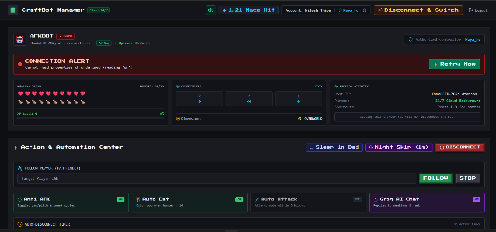
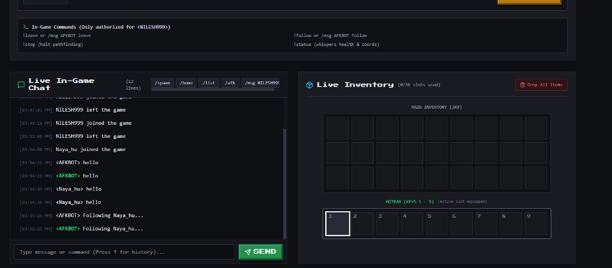
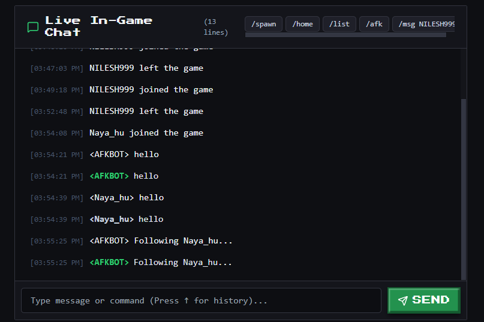

# 🟩 CraftBot 24/7 — Headless Minecraft AFK Bot & Web Dashboard

[](#)
[-blue)](#)
[](#)
[](#)

A full-stack, headless Minecraft AFK bot platform with an authentic **Minecraft-themed web dashboard** designed for 24/7 continuous cloud operation. Keep your mob grinders running, crop farms growing, and chunks loaded without keeping your personal computer turned on!

---

## 📸 Screenshots & Dashboard Tour

### 🎛️ Real-Time Action & Automation Center


### 📊 Live Vitals HUD & Session Activity


### 💬 Synchronized In-Game Chat & Interactive 9x4 Inventory


---

## ✨ Features Overview

### ☁️ 24/7 Cloud Background & Reconnect Resilience
* **Runs in Background**: Operates as a persistent daemon. You can close your browser tab or turn off your computer; the bot stays active in-game.
* **Auto-Persistence on Restarts**: Saved bot sessions (`active_bots.json`) auto-respawn within 20–30s whenever the cloud container or host reboots.
* **Smart Exponential Backoff**: When the Minecraft server restarts or goes offline, CraftBot retries across 5 attempts (5s $\to$ 15s $\to$ 30s $\to$ 60s $\to$ 120s) with a live HUD countdown and an instant **"⚡ Retry Now"** button.
* **1-Click Render.com & UptimeRobot**: Deploy for free on Render and use UptimeRobot to ping `/health` every 5 minutes so the service never sleeps!

---

### 🤖 Groq Llama-3.1 AI Chat Companion
* **Instant Inference (~200ms)**: Powered by Groq LPU inference (`llama-3.1-8b-instant`).
* **Short-Term Context Memory**: Remembers recent conversation context (last 3 turns) while chatting with players in-game.
* **Auto-Wipe on Disconnect**: The moment the bot disconnects or leaves, its temporary memory is wiped clean.
* **Helpful Error Diagnostics**: If the Groq API key is invalid, rate-limited, or offline, the bot provides clear, friendly in-game feedback instead of failing silently.
* **Chat Commands**:
  * `!chat <question>` — Asks anything to the AI companion (or mention `@botname`).
  * `@{botname} <message>` — Greets or chats naturally with the bot.
  * `!ai on` / `!ai off` — Toggle AI chat (Owner only).

---

### 🛏️ Bed Sleeping & Night-Skip System
* **`!sleep` (Auto-Bed Navigation)**:
  * Scans within a **24-block radius** for any bed block (`red_bed`, `white_bed`, etc.).
  * Walks to the bed using pathfinder, hops in, and announces: `🛏️ In bed! Goodnight everyone.`
  * Automatically wakes up in the morning or upon `!wake`.
* **If No Bed Is Found**:
  * Informs players and recommends `!nightskip` so the server can turn into daytime.
* **`!nightskip` (1-Minute Temporary Leave & Auto-Rejoin)**:
  * Disconnects for 60 seconds so other players on the server can sleep and pass the night.
  * **Auto-rejoins automatically after 60 seconds** without requiring the owner to reopen the web dashboard!
* **Accidental `!leave` Protection**:
  * Typing `!leave` or `!quit` will **not** kill the bot. It warns the player to use `!nightskip` instead.
* **`!shutdown bot` (Permanent Poweroff)**:
  * Strict syntax reserved for the **Owner Only** to prevent accidental termination.

---

### 👑 In-Game Ownership Transfer & Dynamic Username Switch
* **`✏️ Change` Button (HUD)**:
  * Click the `✏️ Change` button directly beside the bot username in the dashboard HUD.
  * Enter a new Minecraft username: the bot announces the change in chat, cleanly disconnects, updates disk persistence, and **automatically rejoins the server in 10 seconds**!
* **`!rename <NewUsername>`**:
  * The owner can also switch the bot's username directly via in-game Minecraft chat.
* **`!transfer <NewOwnerIGN>`**:
  * The current owner can reassign bot ownership in-game to another player at any time.
  * Validates the player's username, broadcasts the change to the web dashboard, and saves the new owner to persistence.

---

### 🎮 Authentic Full-Screen Minecraft Dashboard
* **Full-Screen Layout (`max-w-[1920px]`)**: Retro stone panels, beveled borders, and custom Minecraft pixel fonts.
* **Quick Vitals Strip**: Live numeric Health (`20/20 HP`), Hunger (`20/20`), and Coordinates ($X, Y, Z$) directly beside the inventory.
* **Interactive 9x4 Inventory**: Click any slot to **Toss 1**, **Toss All**, or **Equip to Hand/Armor**.
* **Live In-Game Chat**: Bidirectional chat syncing with Minecraft with 800ms client & server deduplication.
* **1.21 Mace Smash Animation**: Interactive single-play animation with a prominent close button (`✕`) and Escape key support.
* **Disconnect & Switch**: Safely switch bot accounts or servers while staying permanently logged in.

---

## 📜 In-Game Command Reference

| Command | Allowed Users | Description |
| :--- | :--- | :--- |
| `!help` | Public | Lists available in-game commands |
| `!sleep` / `!bed` | Public | Finds nearest bed (24 blocks), walks to it, and sleeps |
| `!wake` / `!wakeup` | Public | Wakes the bot up from bed |
| `!nightskip` / `!nap` | Public | Leaves for 60s so players can sleep, then auto-rejoins |
| `!chat <question>` | Public | Queries the Groq Llama-3.1 AI companion (alias: `!ask`) |
| `@{botname}` / `!hi` | Public | Greets the bot or chats with AI |
| `!follow` / `!come` | Public | Follows the player calling the bot |
| `!stop` / `!halt` | Public | Stops pathfinding and stays in place |
| `!status` | Public | Reports HP, hunger, coords, dimension, and sleeping status |
| `!shutdown bot` | **Owner Only** | Safely & permanently shuts down the bot |
| `!rename <NewName>` | **Owner Only** | Changes bot username and rejoins in 10 seconds |
| `!transfer <Player>` | **Owner Only** | Transfers bot ownership to another player IGN |
| `!ai on` / `!ai off` | **Owner Only** | Enables or disables Groq AI chat companion |
| `!dropall` / `!toss` | **Owner Only** | Drops all inventory items at the bot's feet |
| `!eat` | **Owner Only** | Consumes food from inventory |
| `!attack` | **Owner Only** | Toggles mob farm auto-attack |

---

## 🚀 Deployment Options

### Option 1: Render.com (Recommended Free 24/7 Cloud Host)
Detailed walkthrough in [**DEPLOY_RENDER.md**](./DEPLOY_RENDER.md).

1. Go to [dashboard.render.com](https://dashboard.render.com/) $\to$ **New +** $\to$ **Web Service**.
2. Connect your repository: `https://github.com/nilesh0199/MinecraftBot.git`
3. Render detects `render.yaml` automatically:
   * **Build Command**: `npm run build`
   * **Start Command**: `npm start`
   * **Health Check Path**: `/health`
4. Add Environment Variable:
   * `GROQ_API_KEY`: *(Get a free key from [console.groq.com](https://console.groq.com/keys))*
5. In [UptimeRobot.com](https://uptimerobot.com), create a free **HTTP monitor** pointing to `https://<your-app>.onrender.com/health` every 5 minutes so it never sleeps!

---

### Option 2: Local Development (Windows / macOS / Linux)

1. **Install dependencies**:
   ```bash
   npm run build
   ```
2. **Start the server**:
   ```bash
   npm start
   ```
3. Open your browser at **`http://localhost:3001`**.

---

## 🛡️ Production Security & Audit

CraftBot features built-in security protections audited with an automated test suite:
* **SSRF Defense**: Blocks connections to private subnets, cloud metadata (`169.254.169.254`), and dangerous ports (SSH, MySQL, Redis).
* **HMAC Session Tokens**: Cryptographically signed tokens to prevent impersonation.
* **Rate Limiting**: Throttles chat and spawn actions to prevent spam kicks and resource abuse.
* **Memory Watchdog**: Monitors heap allocation to ensure stability.

Run the test suite anytime:
```bash
npx ts-node server/tests/security-audit.ts
# RESULTS: 78/78 PRODUCTION AUDIT TESTS PASSED
```

---

## 📄 License
MIT License. Created for the Minecraft community.
